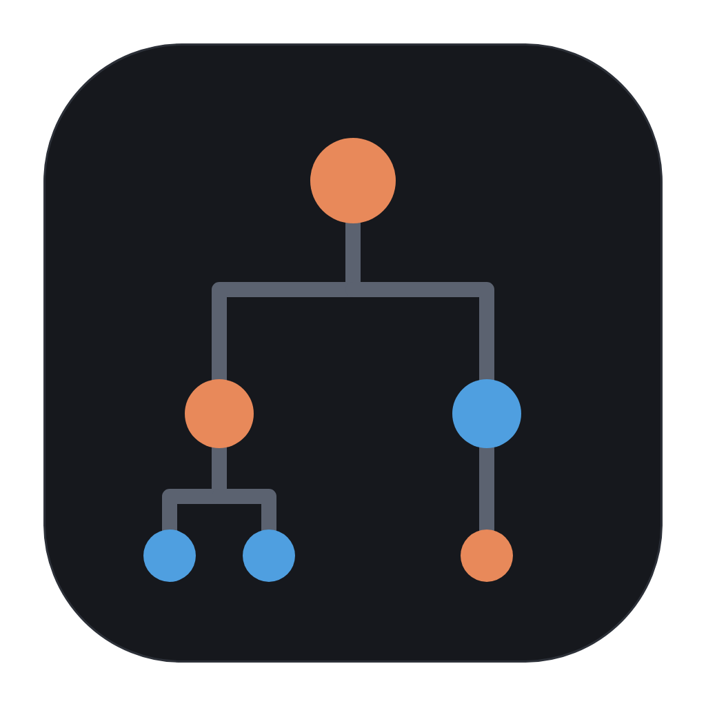
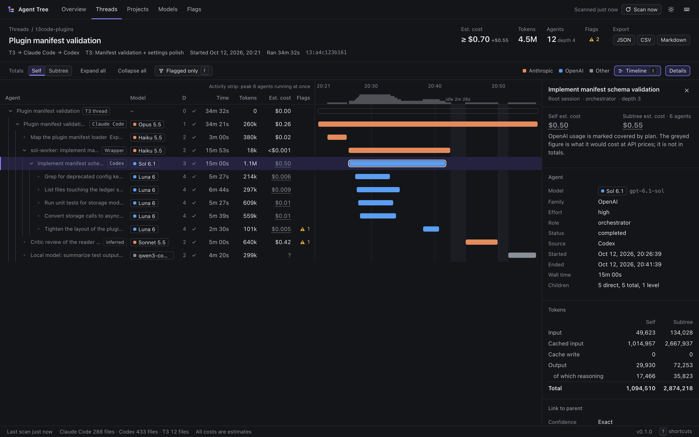
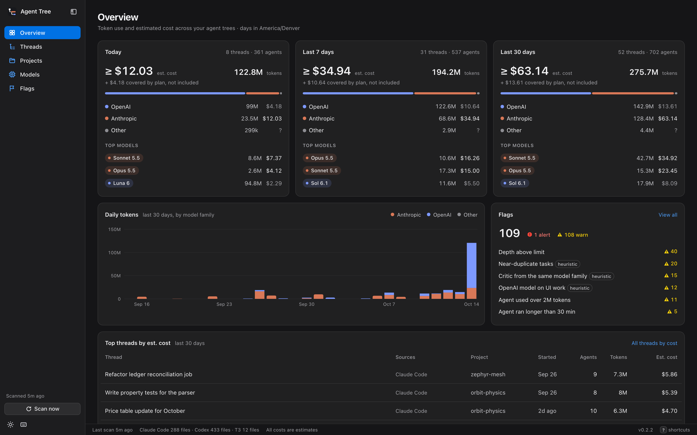

<p align="center">
  
</p>

<h1 align="center">Agent Tree</h1>

<p align="center">
  See where your AI agent usage goes. Agent Tree reads the Claude Code, Codex and T3 Code
  history already on your Mac and shows every agent as a tree: who started whom, which model
  ran, how long it took, how many tokens it used, and roughly what it cost. It also shows your
  plan limits, right from the menu bar.
</p>

<p align="center">
  
</p>

Everything stays on your Mac. It reads local files only, needs no account, and makes no
network calls, so it works the same on or off a VPN.

---

## Download and install

### macOS (one command, recommended)

Open Terminal and paste this:

```sh
curl -fsSL https://raw.githubusercontent.com/Whyater/agent-tree/main/install.sh | sh
```

That's it. It puts **Agent Tree** in your Applications folder, starts it, and adds the `att`
command. No sudo, no Python to install, and no "can't verify the developer" warning.
Run the same line again to update.

Prefer clicking? Download the `.dmg` for your Mac from the
[latest release](https://github.com/Whyater/agent-tree/releases/latest) (`arm64` for Apple
silicon, `x86_64` for Intel) and drag **Agent Tree** into Applications. The app isn't
notarized, so the first time macOS blocks it: go to **System Settings → Privacy & Security** and
click **Open Anyway**. You only do this once.

### Linux

The same command installs the `att` command into `~/.local` (no sudo). It uses your Python if
it's 3.11 or newer and downloads a private copy otherwise.

```sh
curl -fsSL https://raw.githubusercontent.com/Whyater/agent-tree/main/install.sh | sh
att open
```

`att open` shows the dashboard in your browser. The menu bar app is macOS only.

### Uninstall

```sh
curl -fsSL https://raw.githubusercontent.com/Whyater/agent-tree/main/install.sh | sh -s -- --uninstall
```

This removes the app and the `att` command. Your data in `~/.agent-tree` is kept; delete that
folder too if you want it all gone. `--no-app` installs only the command, `--app-only` only the
app.

### From source

```sh
git clone https://github.com/Whyater/agent-tree.git
cd agent-tree
python3 -m agent_tree open
```

No dependencies beyond Python 3.11.

---

## Current features

**Menu bar panel.** Point at the top middle of your screen and a compact panel drops down from
the menu bar. It goes away when you move the pointer off it. It shows:
- Claude and Codex plan limits (session and week) with reset countdowns
- spending for today, 7 days or 30 days (an estimate from list prices)
- what's running right now and for how long
- the live agent tree of your current thread, with subagents that started their own subagents
- a 30-day trend and your most recent threads

**Three ways to run it** (Settings → Mode):
- **Menu bar panel**: the drop-down above, nothing in the Dock.
- **Inside Vorssaint**: Agent Tree runs in the background and shows up as a card in
  [Vorssaint](https://github.com/vorssaint/vorssaint-utils)'s AI Agents panel. Click the card
  to open the full view. This needs a Vorssaint build with the Agent Tree card; the
  [guide](docs/GUIDE.md#inside-vorssaint) shows how to build one. In this mode Agent Tree's own
  drop-down stays off, so the two never overlap.
- **Desktop app**: a normal window with a Dock icon. The drop-down panel is optional here.

**Full view.** The whole history in one window: every thread across every project, the
collapsible agent tree next to a timeline, per-project and per-model totals, flags, and
exports (JSON, CSV, or a Markdown tree for your notes).

<p align="center">
  
</p>

**Plan limits without the network.** Claude limits come from the Claude desktop app's own usage
history and Codex limits from Codex's session logs. Reset times for Claude are estimates,
shown with a "≈".

**Live updates.** The app picks up new Claude Code, Codex and T3 Code activity within about ten
seconds of it happening, and stays idle when nothing is running.

**Claude Code connection (optional).** One click in Settings adds a status line and two
subagent hooks to Claude Code, so live subagents and exact Claude reset times show up.
It saves a backup first, and Disconnect undoes it.

**Cross-checks.** If T3 Code or Vorssaint is installed, Agent Tree compares its token totals
and prices with theirs and shows the result in Settings.

**Flags.** Rules you can tune for things like trees nested too deep, agents running too long,
an expensive model on a trivial task, or a reviewer from the same model family as the builder.

**Command line.** `att` does everything from a terminal: `att threads`, `att tree <id>`,
`att top`, `att flags`, `att export`, `att doctor`.

Details on data sources, costs, flags and privacy are in the [guide](docs/GUIDE.md).

---

## Planned features

- An Agent Tree card in the official Vorssaint app, if its maintainers accept the change.
- Notarized builds, so the first-launch warning goes away.
- More agent tools (OpenCode, GitHub Copilot) where they keep local logs.

---

## Known bugs and limitations

- **Inside Vorssaint** only works with a Vorssaint build that includes the Agent Tree card.
  The official Vorssaint download doesn't have it yet, so for now you build Vorssaint yourself
  ([how](docs/GUIDE.md#inside-vorssaint)). Agent Tree only picks this mode by itself when it
  finds the card.
- Claude **reset times are estimates** unless Claude Code is connected. Claude Code only shares
  exact reset times with its status line.
- Costs are **list-price estimates**. They don't know about plan discounts, batch pricing or
  your actual bill. Models missing from `prices.toml` show "?".
- The drop-down panel hasn't been tested on a Mac with a notch yet; on other screens it uses
  the middle of the menu bar.
- The file formats it reads aren't public APIs and can change with any Claude Code, Codex or
  T3 Code update. `att doctor` reports anything it couldn't read.
- The menu bar app is macOS only (13 or newer). The command line and dashboard also run on Linux.

---

## Privacy

- Reads local files only and never sends anything anywhere.
- Never reads prompts, replies, or tool output: only token counts, timing, models, and short
  task descriptions (cut to 160 characters, with anything that looks like a key removed).
- Never writes to Claude Code, Codex or T3 Code folders, except the Claude Code connection
  above, and only when you click it.
- Everything it stores is in `~/.agent-tree`. Delete that folder to remove it all.

---

## Building it yourself

```sh
python3 -m unittest discover -s tests -t .   # tests, no real data needed
packaging/build_app.sh                        # Agent Tree.app and the .dmg (needs Xcode or its Command Line Tools)
```

## License

MIT
